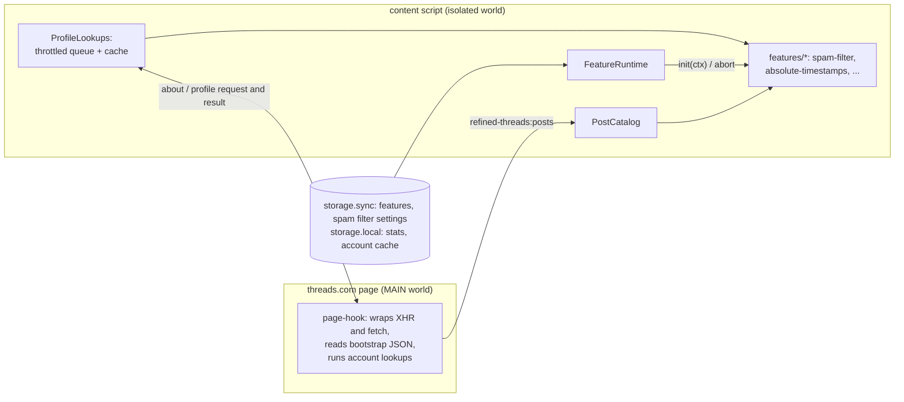

# Refined Threads

A browser extension that makes Threads web (`threads.com`, `threads.net`) better, one small feature at a time. Each feature can be turned on or off, and each has its own settings page. Anyone can contribute a feature: see [CONTRIBUTING.md](CONTRIBUTING.md).

The name follows [Refined GitHub](https://github.com/refined-github/refined-github), a browser extension that makes GitHub cleaner. Refined Threads is not affiliated with Meta or with Refined GitHub. License: MIT.

## Features

| Feature | On by default | What it does |
| --- | --- | --- |
| Spam filter (`spam-filter`) | Yes | Hides or tags spam and bot posts. Levels (Light, Balanced, Strict), blocked words and sites, hidden and allowed accounts, account checks (country, age, followers, posts), user-defined scoring rules, and shareable settings files with presets. |
| Real dates (`absolute-timestamps`) | No | Shows the date of each post instead of "5h". Users choose the format (medium, short, long, ISO, US, European, or a custom pattern such as `ddd, MMM D · HH:mm`), whether to show the time, and whether to keep "5h" in front. The settings page shows a live preview. |
| Keyboard navigation (`keyboard-navigation`) | No | `j` and `k` move between posts, `o` opens the selected post. |
| Account info (`account-info`) | No | Shows a small line of details under each author's name. Each detail has its own switch: whether the author follows you, whether you follow them, country flag, country name (🏴 when the account hides its location), how long the account has been on Threads, follower count, and post count. Location, age, and the follow details need a logged-in Threads session. Threads does not publish how many accounts someone follows, so there is no following count. |

The settings page lists every feature with a switch, a search box, and a settings page per feature. The popup has a switch for every feature, plus the spam filter's daily count and level. Changes apply to open Threads tabs at once.

The settings page, popup, and welcome page use Threads' design: monochrome surfaces, Threads' outline grays, black or white primary buttons and switches, and the system font, in light and dark mode.

On the page, everything follows the Threads theme (light or dark, set in Threads) through Threads' own `--barcelona-*` CSS variables:

- A hidden post folds into one bar with a short reason, such as "Hidden · affiliate link", and a Show button.
- A tagged post gets a small chip after the author name, with × for "Not spam".
- Account details sit on a small gray line under the author name, inside Threads' own header grid, so the post menu does not move.

## How it works



- **Features.** Each folder in `src/features/` is one feature. `src/features/registry.ts` finds them with `import.meta.glob`, so adding a folder is enough. A feature is `defineFeature({ id, enabledByDefault, options, include, shortcuts, init })`. Its `init(ctx)` gets an `AbortSignal` that aborts when the user turns it off or changes its options. This follows Refined GitHub's feature model.
- **Runtime.** `src/features/runtime.ts` reads `sync:features`, starts the enabled features, restarts a feature only when its own options change, and reports a broken feature without stopping the others.
- **Settings pages.** The options page builds a form from each feature's `options` spec. A feature can add its own `Settings.vue`.
- **Capture.** `entrypoints/page-hook.content.ts` runs in the page's MAIN world at `document_start`. It reads posts from the server-rendered `script[type="application/json"]` tags and from `/graphql/query` responses. Threads loads posts through XMLHttpRequest, and the hook also wraps `fetch`. It captures the page's session fields from GraphQL request bodies so it can call the "About this profile" endpoint.
- **Account lookups.** `src/profile/lookups.ts` runs one request at a time per kind (1.5 s gap for About, 2 s for profile pages), newest first. It backs off after HTTP 429 (30 s, doubling to 5 min) and caches results for 30 days (About), 7 days (profile), or 1 day (failures). Lookups run only when an enabled feature or rule needs them, only for posts within 200 px of the screen, and never while the tab is hidden. A lookup that runs before the page session is ready waits and tries again instead of counting as a failure. Follower counts that Threads already loads for itself (for example, when you open a profile) are copied into the same cache, so an account whose count was seen this way needs no profile request when only the follower count is used.
- **Spam filter.** `src/rules/engine.ts` compiles rules once and evaluates posts as a pure function. `src/features/spam-filter/` applies the verdicts to `[data-pressable-container="true"]` containers without removing Threads nodes.
- **UI.** The options page, popup, and welcome page use Vue 3.6 Vapor mode (`<script setup vapor>`, `createVaporApp`).

### Data sources on Threads

These facts were checked on the real site on 2026-11-12.

| Data | Source | Notes |
| --- | --- | --- |
| Post text, links, mentions, AI label, reply info, counts, author handle, verified, follow state | Bootstrap JSON and GraphQL responses (`BarcelonaFeedPaginationDirectQuery`, `BarcelonaCustomFeedRefetchableQuery`, `BarcelonaSearchResultsRefetchableQuery`, `BarcelonaActivityFeedV2ListPaginationQuery`) | Posts are found by shape (`code`, `pk`, `user`), not by query name, because Meta rotates query IDs. |
| Account country and join date | `POST /async/wbloks/fetch/?appid=com.bloks.www.text_post_app.about_this_profile_async_action` | Needs the page session fields and the `WebBloksVersioningID` value. The country name and join date are localized (for example "日本", "2023年7月"). `Intl.DisplayNames` maps names to ISO codes. |
| Follower and post count | `<meta name="description">` of `https://www.threads.com/@handle` | For example "フォロワー100人・スレッド4,515 件". The extension streams the page and stops at the meta tag, about 110 KB of a 680 KB page. |

The feed data has no follower count, post count, account age, or view count.

## Spam filter settings file

The spam filter's Share tab exports this format. Import and the advanced editor accept it.

```json
{
  "format": "refined-threads-settings",
  "name": "My spam filter",
  "description": "Optional text for the people you share it with.",
  "settings": {
    "level": "balanced",
    "tagOnly": false,
    "display": "collapse",
    "ruleFile": {
      "version": 1,
      "scoring": {
        "posts": { "tagAt": 2, "hideAt": 3 },
        "replies": { "tagAt": 2, "hideAt": 3 }
      },
      "rules": [
        {
          "id": "giveaway-bots",
          "name": "Giveaway bots",
          "enabled": true,
          "target": "replies",
          "effect": "score",
          "score": 2,
          "when": {
            "all": [
              { "field": "text", "contains_any": ["giveaway", "抽獎"] },
              { "field": "author.followers", "lt": 50 }
            ]
          }
        }
      ]
    }
  }
}
```

Rule fields:

| Key | Values |
| --- | --- |
| `id` | Lower-case letters, digits, and `-`. Import merges rules by `id`. |
| `effect` | `hide`, `tag`, `score` (adds `score` points, -100 to 100), `allow` (never act on the post). |
| `target` | `all`, `posts`, `replies`. |
| `when` | A condition. Combine with `all`, `any`, and `not`. |

Condition operators: `is`, `in`, `matches` (regular expression, case-insensitive, at most 200 characters), `contains_any`, `host_in` (link host or its subdomains), `gt`, `lt`. On list fields, `gt` and `lt` compare the list length.

Fields: `text`, `links`, `mentions`, `language`, `hasAiLabel`, `isPaidPartnership`, `isReply`, `selfReplyLinks` (links in the author's own replies in the same thread), `copies` (accounts that posted the same text), `author.username`, `author.fullName`, `author.bio`, `author.isVerified`, `author.isPrivate`, `author.following`, `author.followedBy`, `author.country` (ISO code), `author.ageMonths`, `author.followers`, `author.posts`, `counts.likes`, `counts.replies`, `counts.reposts`, `counts.quotes`.

Built-in spam filter rules have fixed ids (`followed`, `allowed-accounts`, `hidden-accounts`, `blocked-words`, `blocked-sites`, `countries`, `new-accounts`, `few-followers`, `few-posts`, `affiliate-links`, `engagement-bait`, `copy-paste-replies`, `ai-label`, `generated-names`, `strangers-in-replies`). The settings page edits them. Rule files contain no code.

## Development

Requirements: Node 24 and pnpm.

```sh
pnpm install
pnpm dev            # Chrome with hot reload
pnpm dev:firefox    # Firefox with hot reload
pnpm check          # typecheck, tests, Chrome build, Firefox build
pnpm zip            # store package for Chrome and Edge
pnpm zip:firefox    # store package for Firefox Add-ons
pnpm bench          # spam filter work for DOM noise and arriving posts (timings and full scans)
pnpm icons          # regenerate public/icon/*.png from assets/icon/option-3.png
```

To load a build by hand, open `chrome://extensions`, turn on developer mode, and load `.output/chrome-mv3`. In Firefox, open `about:debugging#/runtime/this-firefox` and load `.output/firefox-mv3/manifest.json`.

## Not built yet

- **Store release.** Store listings, screenshots, and a privacy policy for the Chrome Web Store, Edge Add-ons, and Firefox Add-ons.
- **Safari.** It needs an Xcode wrapper and an Apple Developer account.
