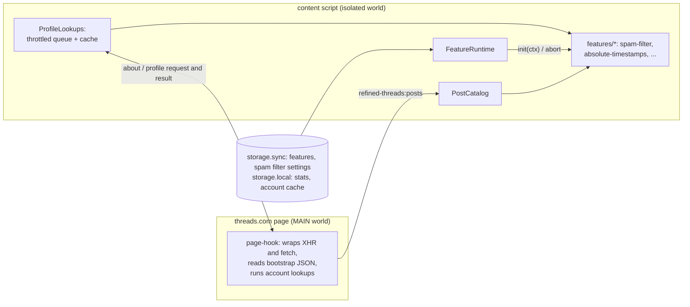

# Refined Threads

[](https://github.com/hannoeru/refined-threads/actions/workflows/ci.yml)

A collection of small, switchable features that make Threads web better, including a spam and bot filter. Inspired by [Refined GitHub](https://github.com/refined-github/refined-github). It runs on `threads.com` and `threads.net`. To contribute a feature, read [CONTRIBUTING.md](CONTRIBUTING.md).

Refined Threads is not affiliated with Meta or with Refined GitHub. License: MIT.

## Features

Each feature has its own switch and its own page of settings. The settings page and the popup list every feature, and changes apply to open Threads tabs at once.

- [Spam filter](docs/features/spam-filter.md) hides or tags spam and bot posts. On by default.
- [Account info](docs/features/account-info.md) shows a short line of account details under each author name. On by default.
- [Keyboard navigation](docs/features/keyboard-navigation.md) moves between posts with `j` and `k`. On by default.
- [Real dates](docs/features/absolute-timestamps.md) shows the date of each post instead of "5h". Off by default.

Everything the extension draws on Threads follows the Threads theme, light or dark, through Threads' own `--barcelona-*` CSS variables.

## How it works



- **Features.** Each folder in `src/features/` is one feature. `src/features/registry.ts` finds them with `import.meta.glob`, so adding a folder is enough. A feature is `defineFeature({ id, enabledByDefault, options, include, shortcuts, init })`. Its `init(ctx)` gets an `AbortSignal` that aborts when the user turns it off or changes its options. This follows Refined GitHub's feature model.
- **Runtime.** `src/features/runtime.ts` reads `sync:features`, starts the enabled features, restarts a feature only when its own options change, and reports a broken feature without stopping the others.
- **Settings pages.** The options page builds a form from each feature's `options` spec. A feature can add its own `Settings.vue`.
- **Capture.** `entrypoints/page-hook.content.ts` runs in the page's MAIN world at `document_start`. It reads posts from the server-rendered `script[type="application/json"]` tags and from `/graphql/query` responses. Threads loads posts through XMLHttpRequest, and the hook also wraps `fetch`. It captures the page's session fields from GraphQL request bodies so it can call the "About this profile" endpoint.
- **Account lookups.** `src/profile/lookups.ts` runs one request at a time per kind (1.5 s gap for About, 2 s for profile pages), newest first. It backs off after HTTP 429 (30 s, doubling to 5 min) and caches results for 30 days (About), 7 days (profile), or 1 day (failures). Lookups run only when an enabled feature or rule needs them, only for posts within 200 px of the screen, and never while the tab is hidden. A lookup that runs before the page session is ready waits and tries again instead of counting as a failure. Follower counts that Threads already loads for itself (for example, when you open a profile) are copied into the same cache, so an account whose count was seen this way needs no profile request when only the follower count is used.
- **Spam filter.** `src/rules/engine.ts` compiles rules once and evaluates posts as a pure function. The rule file format is in [docs/features/spam-filter.md](docs/features/spam-filter.md#settings-file). `src/features/spam-filter/` applies the verdicts to `[data-pressable-container="true"]` containers without removing Threads nodes.
- **UI.** The options page, popup, and welcome page use Vue 3.6 Vapor mode (`<script setup vapor>`, `createVaporApp`).

### Data sources on Threads

These facts were checked on the real site on 2026-11-12.

| Data                                                                                            | Source                                                                                                                                                                                                     | Notes                                                                                                                                                                                            |
| ----------------------------------------------------------------------------------------------- | ---------------------------------------------------------------------------------------------------------------------------------------------------------------------------------------------------------- | ------------------------------------------------------------------------------------------------------------------------------------------------------------------------------------------------ |
| Post text, links, mentions, AI label, reply info, counts, author handle, verified, follow state | Bootstrap JSON and GraphQL responses (`BarcelonaFeedPaginationDirectQuery`, `BarcelonaCustomFeedRefetchableQuery`, `BarcelonaSearchResultsRefetchableQuery`, `BarcelonaActivityFeedV2ListPaginationQuery`) | Posts are found by shape (`code`, `pk`, `user`), not by query name, because Meta rotates query IDs.                                                                                              |
| Account country and join date                                                                   | `POST /async/wbloks/fetch/?appid=com.bloks.www.text_post_app.about_this_profile_async_action`                                                                                                              | Needs the page session fields and the `WebBloksVersioningID` value. The country name and join date are localized (for example "日本", "2023年7月"). `Intl.DisplayNames` maps names to ISO codes. |
| Follower and post count                                                                         | `<meta name="description">` of `https://www.threads.com/@handle`                                                                                                                                           | For example "フォロワー100人・スレッド4,515 件". The extension streams the page and stops at the meta tag, about 110 KB of a 680 KB page.                                                        |

The feed data has no follower count, post count, account age, or view count.

## Install

Store listings are not ready yet. To use it today:

1. Download the zip for your browser from the latest [release](https://github.com/hannoeru/refined-threads/releases), or build it yourself (see Development).
2. **Chrome, Edge, Brave, Arc.** Unzip it, open `chrome://extensions`, turn on developer mode, choose "Load unpacked", and select the folder.
3. **Firefox and Zen.** Open `about:debugging#/runtime/this-firefox`, choose "Load Temporary Add-on", and select the zip. Firefox removes temporary add-ons when it restarts.

## Privacy

Refined Threads has no server and no analytics. It stores settings in your browser and talks only to Threads. See [PRIVACY.md](PRIVACY.md).

## Development

Requirements: Node 24 and pnpm 12 (`corepack enable` installs the version in `package.json`).

```sh
pnpm install
pnpm dev            # Chrome with hot reload
pnpm dev:firefox    # Firefox with hot reload
pnpm lint           # @antfu/eslint-config (pnpm lint:fix to fix)
pnpm check          # lint, typecheck, tests, Chrome build, Firefox build
pnpm zip            # store package for Chrome and Edge
pnpm zip:firefox    # store package for Firefox Add-ons
pnpm bench          # spam filter work for DOM noise and arriving posts (timings and full scans)
pnpm icons          # regenerate public/icon/*.png from assets/icon/source.png
```

To load a build by hand, open `chrome://extensions`, turn on developer mode, and load `.output/chrome-mv3`. In Firefox, open `about:debugging#/runtime/this-firefox` and load `.output/firefox-mv3/manifest.json`.

CI runs `pnpm check` on every push and pull request. Pushing a `v*` tag that matches the `package.json` version creates a draft GitHub release with the Chrome and Firefox zips. Publishing that release submits the Chrome zip to the Chrome Web Store. See [RELEASING.md](RELEASING.md). Dependabot opens weekly update pull requests for packages and GitHub Actions.

Agents can drive the extension on the real site with the project skill in `.agents/skills/verify-refined-threads/`.

## Contributing

Read [CONTRIBUTING.md](CONTRIBUTING.md) to add a feature. Report bugs and ideas with the [issue forms](https://github.com/hannoeru/refined-threads/issues/new/choose), and security problems through [SECURITY.md](SECURITY.md). This project follows the [code of conduct](CODE_OF_CONDUCT.md).

## Not built yet

- **Store release.** Store listings and screenshots for the Chrome Web Store, Edge Add-ons, and Firefox Add-ons. The privacy policy for the listings is [PRIVACY.md](PRIVACY.md).
- **Safari.** It needs an Xcode wrapper and an Apple Developer account.

## License

[MIT](LICENSE)
