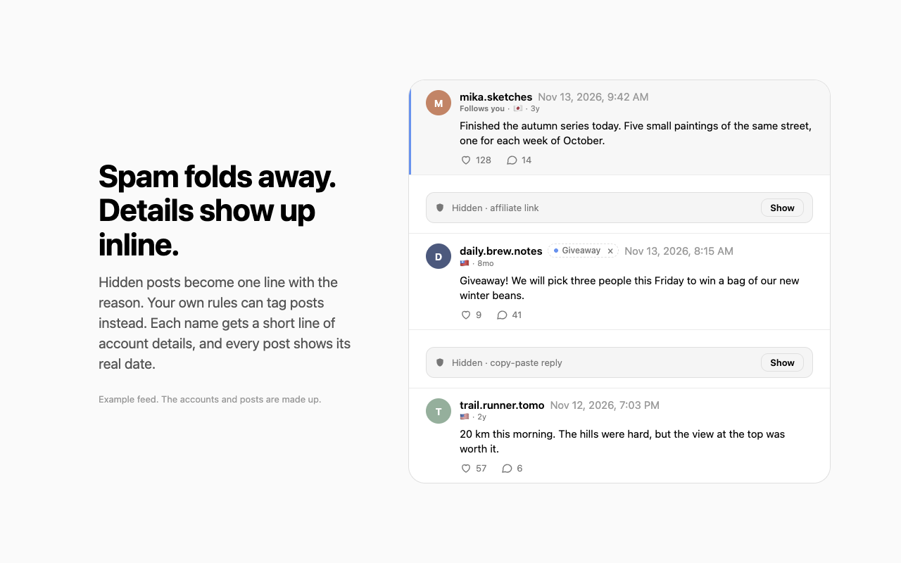

<p align="center">
  
</p>

<h1 align="center">Refined Threads</h1>

<p align="center">
  A collection of small, switchable features that make Threads web better, including a spam and bot filter. Inspired by <a href="https://github.com/refined-github/refined-github">Refined GitHub</a>.
</p>

<p align="center">
  <a href="#install">Install</a> ·
  <a href="#features">Features</a> ·
  <a href="#privacy">Privacy</a> ·
  <a href="#contributing">Contributing</a> ·
  <a href="https://github.com/sponsors/hannoeru">Sponsor</a>
</p>

<p align="center">
  <a href="https://github.com/hannoeru/refined-threads/actions/workflows/ci.yml"></a>
</p>



## Install

The Chrome Web Store, Edge Add-ons, and Firefox Add-ons listings are on the way. Until then, install the latest release by hand. It takes about a minute.

### Chrome, Edge, Brave, and Arc

1. Download `refined-threads-<version>-chrome.zip` from the [latest release](https://github.com/hannoeru/refined-threads/releases/latest), and unzip it.
2. Open `chrome://extensions` (in Edge, `edge://extensions`).
3. Turn on **Developer mode**.
4. Choose **Load unpacked**, and select the unzipped folder.
5. Open [threads.com](https://www.threads.com). The spam filter, account info, and keyboard navigation are already on.

The browser keeps the extension after a restart. To update, unzip the new release into the same folder, replacing the old files, then choose the reload button on the extension's card. Your settings stay.

### Firefox and Zen

1. Download `refined-threads-<version>-firefox.zip` from the [latest release](https://github.com/hannoeru/refined-threads/releases/latest).
2. Open `about:debugging#/runtime/this-firefox`.
3. Choose **Load Temporary Add-on**, and select the zip file.

Firefox removes a temporary add-on when it restarts. A permanent install will come with the Firefox Add-ons listing.

## Features

Each feature has its own switch and its own settings. Open them from the toolbar popup or the extension's settings page. Changes apply to open Threads tabs at once.

- [Spam filter](docs/features/spam-filter.md) hides or tags spam and bot posts. On by default.
- [Account info](docs/features/account-info.md) shows a short line of account details under each author name. On by default.
- [Keyboard navigation](docs/features/keyboard-navigation.md) moves between posts with `j` and `k`. On by default.
- [Real dates](docs/features/absolute-timestamps.md) shows the date of each post instead of "5h". Off by default.

Everything the extension draws on Threads follows the Threads theme, light or dark.

Safari is not supported. It needs an Xcode wrapper and an Apple Developer account.

## Privacy

Refined Threads has no server, no account, no analytics, and no tracking. Your settings stay in your browser, and the extension talks only to Threads. It never likes, follows, or blocks anything for you. Read the full [privacy policy](PRIVACY.md).

## Contributing

- **Report a bug or suggest an idea** with the [issue forms](https://github.com/hannoeru/refined-threads/issues/new/choose).
- **Add a feature.** [CONTRIBUTING.md](CONTRIBUTING.md) walks through one, step by step.
- **Report a security problem** privately, as [SECURITY.md](SECURITY.md) describes.
- **Support the work** by [sponsoring the maintainer on GitHub](https://github.com/sponsors/hannoeru).

This project follows the [code of conduct](CODE_OF_CONDUCT.md).

### Development

You need Node 24 and pnpm 12. `corepack enable` installs the pnpm version in `package.json`.

```sh
pnpm install
pnpm dev            # Chrome with hot reload
pnpm dev:firefox    # Firefox with hot reload
pnpm check          # lint, typecheck, tests, Chrome build, Firefox build
```

`package.json` lists the other scripts. To load a build by hand, load `.output/chrome-mv3` as an unpacked extension, or `.output/firefox-mv3/manifest.json` as a temporary add-on in Firefox.

- [docs/architecture.md](docs/architecture.md) explains how the extension captures posts, looks up accounts, and runs features.
- [RELEASING.md](RELEASING.md) covers tags, releases, and the store workflow.
- `.agents/skills/` holds skills that let coding agents test the extension on threads.com and keep the store listing current.

CI runs `pnpm check` on every push and pull request. Dependabot opens weekly update pull requests.

## License

[MIT](LICENSE). Refined Threads is not affiliated with Meta or with Refined GitHub.
