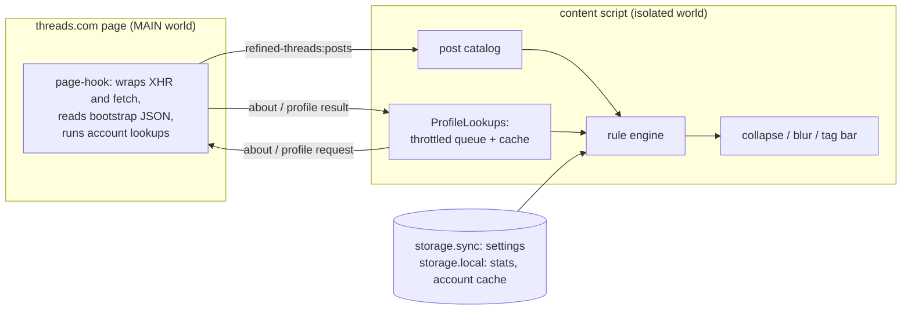

# Refined Threads

A browser extension that hides or tags spam and bot posts on Threads web (`threads.com`, `threads.net`). It works on install with no setup. Users can tune it with simple switches, write their own scoring rules, and share their settings as a JSON file.

The name follows [Refined GitHub](https://github.com/refined-github/refined-github), a browser extension that makes GitHub cleaner. Refined Threads is not affiliated with Meta or with Refined GitHub. License: MIT.

## What users get

- **Works on install.** The "Balanced" level hides affiliate spam, engagement bait, and copy-paste replies. The welcome page lets the user pick Light, Balanced, or Strict.
- **Hide or tag.** Every rule can hide a post, tag it, add points, or protect it. A hidden post folds into one thin bar with its reason and a Show button. After Show, "Not spam" allows the author and "Keep hiding" folds it again. A tagged post stays visible with a small bar.
- **Points.** Points from all matching rules add up. Posts and replies each have a "tag at" and a "hide at" number.
- **Account checks.** Rules can read the account country, the account age, the follower count, and the post count. The extension looks these up only when an enabled rule needs them.
- **Words and accounts.** Blocked words, blocked sites, hidden accounts, and allowed accounts. A right-click menu on profile links hides or allows an account.
- **Share and presets.** Export settings to a JSON file, import a friend's file (add to mine or replace mine), or add a built-in preset. An advanced JSON editor validates the file before it saves.
- **Test mode.** "Tag only, never hide" turns every hide into a tag.
- **Languages.** English and Traditional Chinese.

## How it works



- `entrypoints/page-hook.content.ts` runs in the page's MAIN world at `document_start`. It reads posts from the server-rendered `script[type="application/json"]` tags and from `/graphql/query` responses. Threads loads posts through XMLHttpRequest, and the hook also wraps `fetch`. It captures the page's session fields from GraphQL request bodies so it can call the "About this profile" endpoint.
- `entrypoints/content/index.ts` runs in the isolated world. It keeps a post catalog keyed by post code, evaluates each `[data-pressable-container="true"]` container, and applies the verdict without removing Threads nodes.
- `src/rules/engine.ts` compiles rules once and evaluates posts as a pure function.
- `src/profile/lookups.ts` runs one request at a time per kind (1.5 s gap for About, 2 s for profile pages), newest first. It backs off after HTTP 429 (30 s, doubling to 5 min) and caches results for 30 days (About), 7 days (profile), or 1 day (failures).
- The options page, popup, and welcome page use Vue 3.6 Vapor mode (`<script setup vapor>`, `createVaporApp`).

### Data sources on Threads

These facts were checked on the real site on 2026-11-12.

| Data | Source | Notes |
| --- | --- | --- |
| Post text, links, mentions, AI label, reply info, counts, author handle, verified, follow state | Bootstrap JSON and GraphQL responses (`BarcelonaFeedPaginationDirectQuery`, `BarcelonaCustomFeedRefetchableQuery`, `BarcelonaSearchResultsRefetchableQuery`, `BarcelonaActivityFeedV2ListPaginationQuery`) | Posts are found by shape (`code`, `pk`, `user`), not by query name, because Meta rotates query IDs. |
| Account country and join date | `POST /async/wbloks/fetch/?appid=com.bloks.www.text_post_app.about_this_profile_async_action` | Needs the page session fields and the `WebBloksVersioningID` value. The country name and join date are localized (for example "日本", "2023年7月"). `Intl.DisplayNames` maps names to ISO codes. |
| Follower and post count | `<meta name="description">` of `https://www.threads.com/@handle` | For example "フォロワー100人・スレッド4,515 件". The extension streams the page and stops at the meta tag, about 110 KB of a 680 KB page. |

The feed data has no follower count, post count, account age, or view count.

## Settings file

Export writes this format. Import and the advanced editor accept it.

```json
{
  "format": "refined-threads-settings",
  "name": "My spam filter",
  "description": "Optional text for the people you share it with.",
  "settings": {
    "level": "balanced",
    "tagOnly": false,
    "display": "collapse",
    "ruleFile": {
      "version": 1,
      "scoring": {
        "posts": { "tagAt": 2, "hideAt": 3 },
        "replies": { "tagAt": 2, "hideAt": 3 }
      },
      "rules": [
        {
          "id": "giveaway-bots",
          "name": "Giveaway bots",
          "enabled": true,
          "target": "replies",
          "effect": "score",
          "score": 2,
          "when": {
            "all": [
              { "field": "text", "contains_any": ["giveaway", "抽獎"] },
              { "field": "author.followers", "lt": 50 }
            ]
          }
        }
      ]
    }
  }
}
```

Rule fields:

| Key | Values |
| --- | --- |
| `id` | Lower-case letters, digits, and `-`. Import merges rules by `id`. |
| `effect` | `hide`, `tag`, `score` (adds `score` points, -100 to 100), `allow` (never act on the post). |
| `target` | `all`, `posts`, `replies`. |
| `when` | A condition. Combine with `all`, `any`, and `not`. |

Condition operators: `is`, `in`, `matches` (regular expression, case-insensitive, at most 200 characters), `contains_any`, `host_in` (link host or its subdomains), `gt`, `lt`. On list fields, `gt` and `lt` compare the list length.

Fields: `text`, `links`, `mentions`, `language`, `hasAiLabel`, `isPaidPartnership`, `isReply`, `selfReplyLinks` (links in the author's own replies in the same thread), `copies` (accounts that posted the same text), `author.username`, `author.fullName`, `author.bio`, `author.isVerified`, `author.isPrivate`, `author.following`, `author.followedBy`, `author.country` (ISO code), `author.ageMonths`, `author.followers`, `author.posts`, `counts.likes`, `counts.replies`, `counts.reposts`, `counts.quotes`.

Built-in rules have fixed ids (`followed`, `allowed-accounts`, `hidden-accounts`, `blocked-words`, `blocked-sites`, `countries`, `new-accounts`, `few-followers`, `few-posts`, `affiliate-links`, `engagement-bait`, `copy-paste-replies`, `ai-label`, `generated-names`, `strangers-in-replies`). The settings page edits them. Rule files contain no code.

## Development

Requirements: Node 24 and pnpm.

```sh
pnpm install
pnpm dev            # Chrome with hot reload
pnpm dev:firefox    # Firefox with hot reload
pnpm check          # typecheck, tests, Chrome build, Firefox build
pnpm zip            # store package for Chrome and Edge
pnpm zip:firefox    # store package for Firefox Add-ons
pnpm icons          # regenerate public/icon/*.png from assets/icon/option-3.png
```

To load a build by hand, open `chrome://extensions`, turn on developer mode, and load `.output/chrome-mv3`. In Firefox, open `about:debugging#/runtime/this-firefox` and load `.output/firefox-mv3/manifest.json`.

## Not built yet

- **Store release.** Store listings, screenshots, and a privacy policy for the Chrome Web Store, Edge Add-ons, and Firefox Add-ons.
- **Safari.** It needs an Xcode wrapper and an Apple Developer account.
- **Report link.** `src/ui/links.ts` points "Report a problem" to `https://github.com/hanlee/refined-threads/issues`. That repository does not exist yet.
