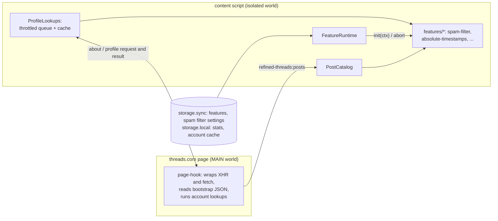

# Architecture

How Refined Threads works inside the browser. For the feature model, read [CONTRIBUTING.md](../CONTRIBUTING.md).

- **Features.** Each folder in `src/features/` is one feature. `src/features/registry.ts` finds them with `import.meta.glob`, so adding a folder is enough. A feature is `defineFeature({ id, enabledByDefault, options, include, shortcuts, init })`. Its `init(ctx)` gets an `AbortSignal` that aborts when the user turns it off or changes its options. This follows Refined GitHub's feature model.
- **Runtime.** `src/features/runtime.ts` reads `sync:features`, starts the enabled features, restarts a feature only when its own options change, and reports a broken feature without stopping the others.
- **Settings pages.** The options page builds a form from each feature's `options` spec. A feature can add its own `Settings.vue`.
- **Capture.** `entrypoints/page-hook.content.ts` runs in the page's MAIN world at `document_start`. It reads posts from the server-rendered `script[type="application/json"]` tags and from `/graphql/query` responses. Threads loads posts through XMLHttpRequest, and the hook also wraps `fetch`. It captures the page's session fields from GraphQL request bodies so it can call the "About this profile" endpoint.
- **Account lookups.** `src/profile/lookups.ts` runs one request at a time per kind (1.5 s gap for About, 2 s for profile pages), newest first. It backs off after HTTP 429 (30 s, doubling to 5 min) and caches results for 30 days (About), 7 days (profile), or 1 day (failures). Lookups run only when an enabled feature or rule needs them, only for posts within 200 px of the screen, and never while the tab is hidden. A lookup that runs before the page session is ready waits and tries again instead of counting as a failure. Follower counts that Threads already loads for itself (for example, when you open a profile) are copied into the same cache, so an account whose count was seen this way needs no profile request when only the follower count is used.
- **Spam filter.** `src/rules/engine.ts` compiles rules once and evaluates posts as a pure function. The rule file format is on the [spam filter page](features/spam-filter.md#settings-file). `src/features/spam-filter/` applies the verdicts to `[data-pressable-container="true"]` containers without removing Threads nodes.
- **UI.** The options page, popup, and welcome page use Vue 3.6 Vapor mode (`<script setup vapor>`, `createVaporApp`).

## Data sources on Threads

These facts were checked on the real site on 2026-11-12.

| Data                                                                                            | Source                                                                                                                                                                                                     | Notes                                                                                                                                                                                            |
| ----------------------------------------------------------------------------------------------- | ---------------------------------------------------------------------------------------------------------------------------------------------------------------------------------------------------------- | ------------------------------------------------------------------------------------------------------------------------------------------------------------------------------------------------ |
| Post text, links, mentions, AI label, reply info, counts, author handle, verified, follow state | Bootstrap JSON and GraphQL responses (`BarcelonaFeedPaginationDirectQuery`, `BarcelonaCustomFeedRefetchableQuery`, `BarcelonaSearchResultsRefetchableQuery`, `BarcelonaActivityFeedV2ListPaginationQuery`) | Posts are found by shape (`code`, `pk`, `user`), not by query name, because Meta rotates query IDs.                                                                                              |
| Account country and join date                                                                   | `POST /async/wbloks/fetch/?appid=com.bloks.www.text_post_app.about_this_profile_async_action`                                                                                                              | Needs the page session fields and the `WebBloksVersioningID` value. The country name and join date are localized (for example "日本", "2023年7月"). `Intl.DisplayNames` maps names to ISO codes. |
| Follower and post count                                                                         | `<meta name="description">` of `https://www.threads.com/@handle`                                                                                                                                           | For example "フォロワー100人・スレッド4,515 件". The extension streams the page and stops at the meta tag, about 110 KB of a 680 KB page.                                                        |

The feed data has no follower count, post count, account age, or view count.
